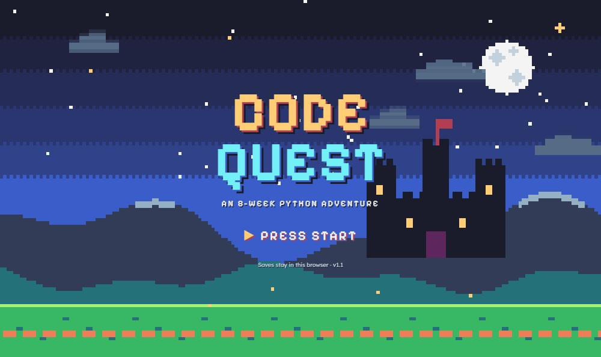

# Code Quest

**An 8-week Python course you play as a pixel-art RPG.** You travel across a map of eight worlds, write real Python in the browser, and every answer is checked automatically: by hidden tests, speed tests and bug-finding tests. Nothing to install, no account, no server.

**▶ Play it: [s9-nine.github.io/Pyworld](https://s9-nine.github.io/Pyworld/)**



## What's in the game

64 levels across 8 worlds. Each world is a week, and each ends in a boss level where you build something real.

| Week | World | You learn | Boss |
| --- | --- | --- | --- |
| 1 | Basics Village | `print`, variables, types, `input()`, maths, `if / elif / else` | The Gatekeeper |
| 2 | Loop Forest | loops, lists, dictionaries, functions | An expense tracker in the terminal |
| 3 | Debug Caves | reading errors, exceptions, files, modules, tests with pytest | A quiz game with saved high scores |
| 4 | Data Desert | nested data, JSON, APIs, SQL with SQLite, SQL injection | A habit tracker backed by a database |
| 5 | Web Kingdom | HTTP, HTML, forms, Flask, JSON APIs, XSS and secrets | A guestbook web app with a database |
| 6 | Capstone Castle | planning an MVP, sets, classes, inheritance, clean code, dates | A study planner with classes and saving |
| 7 | Launch Harbor | Git, merge conflicts, test-first development, READMEs, config, reviewing AI code | A pre-launch project checker |
| 8 | Interview Arena | the interview method, hash maps, two pointers, Big-O, stacks, binary search, recursion | A three-question coding interview |

Every level has five stages:

1. **Learn**: short lessons with code you can run and change.
2. **Think**: puzzles before you code: predict the output, put code lines in order, trace variables, spot the buggy line, or find an input that breaks a function.
3. **Code**: build a program that the checker tests.
4. **Debug**: find and fix a bug in someone else's code.
5. **Explain**: describe your solution in your own words, as you would in an interview.

On top of that: a **Memory Dungeon** of review cards on a spaced-repetition schedule (1, 3, 7, 14 and 30 days), XP, stars, streaks, a daily goal, a skills meter, and "take it home" projects at the end of every world.

## How answers are checked

The checker is the core of the project. It's built to tell whether code really works, not just whether it matches one example.

- **Visible tests** call your functions with normal inputs and edge cases, and explain any failure in plain English.
- **Hidden random tests** run your code on randomly generated inputs and compare the result with a model solution. This catches answers that hard-code the visible tests.
- **Speed tests** use inputs big enough (20,000 to 80,000 items) that a loop inside a loop runs out of time, while an efficient answer finishes in milliseconds.
- **Bug-catching tests** (the pytest level): the player writes the tests, and the checker hides bugs in the code to count how many of them the tests catch.
- **SQL answers** run against a second database with different data, so the query has to be general.
- **HTML answers** are checked by reading the page's structure, not its exact text.
- **Explanations** must read as real sentences in the player's own words and cover the level's key ideas. Then the player sees which ideas they covered and a sample answer to compare with.

## How it works

It's a single HTML page with no backend.

- **Python runs in the browser** using [Skulpt](https://skulpt.org/), which translates Python into JavaScript.
- **SQL runs in the browser** using [sql.js](https://sql.js.org/), a version of SQLite compiled to JavaScript.
- **Practice versions** of `json`, files, `requests`, a Flask test client, `pytest` and `sqlite3` run inside the page, so the web, API and database lessons need no internet access or setup.
- The interface is plain JavaScript and CSS, with no framework. `src/build.js` combines the source files into `index.html`.
- **Progress saves** in the browser (`localStorage`): three save files per browser, each with an optional 4-digit PIN. The PIN only stops people sharing a computer from mixing up saves. It isn't real security.

## Testing

Every level is tested automatically, without a browser:

```bash
node src/verify.js
node src/test-cases.js
```

On Windows, double-click **`Run Tests.bat`** to run both.

- **`verify.js`** checks every level: model answers pass, starting code fails, every planted bug fails until it's fixed, deliberately wrong answers are rejected, every lesson example runs, and every sample explanation passes while gibberish is rejected. That's 64 levels and 1,223 checks.
- **`test-cases.js`** replays 303 saved attempts (correct answers, wrong ones and cheating ones), so a change to the checker can't quietly start accepting a wrong answer.

The first run downloads Skulpt and sql.js into `.vendor/`, which isn't committed.

## Play or edit locally

Open `index.html` in a browser, or on Windows double-click **`Play Code Quest.bat`**. It also downloads game updates from GitHub if Git is installed.

The game files are in `src/`. After changing them, rebuild:

```bash
node src/build.js
```

```
index.html          The built game (open this)
src/
  content.js        Worlds, skills and World 1
  world2.js … world8.js   Worlds 2 to 8: lessons, puzzles, challenges, bugs, review cards
  explain.js        Key ideas and sample answers for every Explain question
  runner.js         Runs Python and SQL, and checks answers
  vmods.js          In-browser practice versions of json, files, requests, Flask, pytest, sqlite3
  app.js            Map, levels, editor, puzzles, Memory Dungeon
  title.js          Title screen, save files, hero creation
  profile.js        Profile page
  pixel.js          Pixel-art hero sprites
  build.js          Builds index.html
  verify.js         Tests every level
  test-cases.js     Replays saved attempts
tests/cases/        Saved attempts for test-cases.js
```
